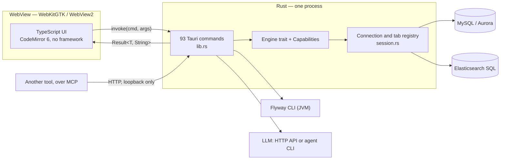
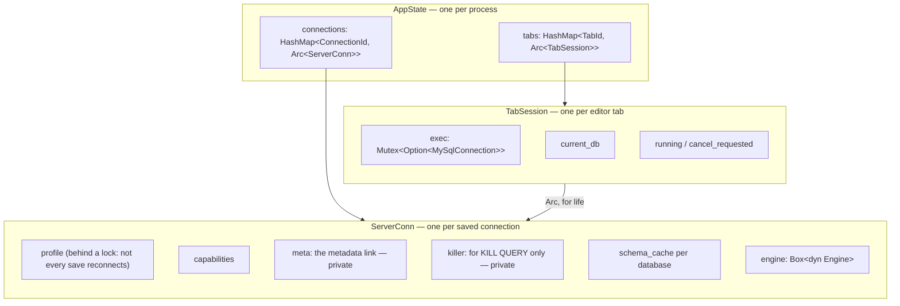
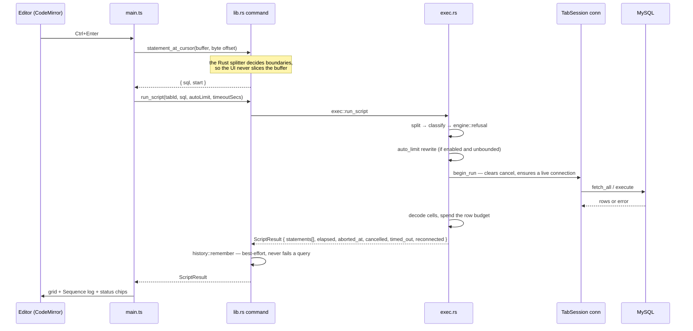

# Architecture

A map of db-query for somebody — or something — opening this repository for the
first time. It says what the parts are, where state lives, and which rules are
load-bearing. It does not repeat the stage trackers in [`docs/`](docs/), which
hold the reasoning behind each decision; where a rule here has a *why*, this
file links to the tracker that argued it.

Read this first, then the module header (`//!`) of whatever you are about to
touch. Those headers are kept current and are usually more specific than
anything here.

---

## 1. What it is

A desktop SQL client: a Tauri 2 application with a TypeScript frontend and a
Rust backend, speaking MySQL over `sqlx` and Elasticsearch SQL over HTTP. It
also runs Flyway migrations, exposes an MCP server so other tools can read the
schema you are connected to, and can ask an LLM to write SQL that **it never
runs for you**.

Two sentences that explain most design decisions:

- **Nothing runs unattended.** Every statement is executed because a person
  pressed something. Generated SQL — an index suggestion, a `DROP`, a migration
  — goes into the editor and waits.
- **Capabilities, not engine names.** What the app offers is driven by a
  `Capabilities` struct the engine returns, never by `if engine == "mysql"`.



The frontend holds no database driver, no credentials and no SQL grammar. It
cannot reach a server except through a command. Everything that decides
*whether* something may happen — may this statement run, may this connection
write, may this engine be diagnosed — is decided in Rust.

---

## 2. The two halves, and the line between them

### The command surface

`src-tauri/src/lib.rs` is the only place `#[tauri::command]` appears. Each
command is thin: resolve the state it needs, call into a module, return
`Result<T, String>`. The error is a sentence meant for a person.

`src/api.ts` is the typed mirror of that surface — one function per command,
with the payload and return types written out. **If you add a command, add it
there in the same change**, or the UI has no way to call it and TypeScript has
no idea it exists.

Three things cross the line other than commands:

| Direction | Mechanism | Used for |
|---|---|---|
| UI → Rust | `invoke` | everything, 93 commands |
| Rust → UI | `Channel` (`@tauri-apps/api/core`) | streaming an assistant reply token by token |
| Rust → UI | window events (`mcp://put-query`, `mcp://put-notes`) | an MCP client asking the app to do something |

### Where the UI's own logic lives

`src/main.ts` is the composition root: it holds the element references, wires
every control, and owns the app-wide state that is not a module's own. The
other 25 modules are each one surface or one concern.

| Module | What it is |
|---|---|
| `api.ts` | the typed command surface |
| `boot.ts` | entry point; puts preferences in place before anything paints |
| `tabs.ts` | script tabs, each with its own CodeMirror state |
| `editor.ts` | CodeMirror 6: MySQL highlighting, schema-aware autocomplete, lint gutter |
| `grid.ts` | the virtualised result grid, one tab per result set |
| `sequence.ts` | what actually ran, as a log (Stage 29) |
| `diagnose.ts` | the plan, the counters and the verdicts (Stage 35) |
| `workload.ts` + `charts.ts` | the performance dock and its chart marks (Stages 31, 33) |
| `connections.ts` | the connection rail |
| `assistant.ts` | the chat panel |
| `history.ts` | the query-history dock |
| `session.ts` | which tabs were open, restored on connect |
| `settings.ts`, `theme.ts`, `prefs` | preferences, light/dark/system |
| `files.ts`, `clipboard.ts`, `dialog.ts`, `menu.ts` | OS-facing bits and the one context menu |
| `exportschema.ts`, `sqlfiles.ts` | the two folder/dialog-driven jobs |
| `treefilter.ts`, `icons.ts`, `coltype.ts`, `markdown.ts` | the schema tree and small renderers |

---

## 3. The connection model

This is the part most worth understanding before changing anything, and the
part least obvious from the file names.



**A tab owns its own connection.** It is created lazily on first run and closed
with the tab. This is why a `USE db` in one tab does not move another, why two
tabs can run at once, and why a session counter read either side of a statement
is attributable to that statement (Stage 35 relies on this).

**The metadata link is separate and private.** The schema tree, autocomplete
and the performance dock share one `meta` connection behind a mutex, reachable
only through `ServerConn::mysql_meta()`. Browsing the schema must not queue
behind a ten-minute query, and a cancel must not queue behind the tree — so
each `ServerConn` holds a **third connection whose only job is `KILL QUERY`**.
Both are private; `mysql_meta()` and `mysql_killer()` are the only way in.

**A connection is not a profile.** `ServerConn.profile` sits behind a lock
because some saves must not reconnect: attaching a dictionary is a save about a
text file, not about the socket. `follow_saved` takes only the fields that are
labels. Before Stage 30 this was a clone taken at connect, and the bug was that
a dictionary stayed invisible until restart.

### Engines

```rust
trait Engine {
    fn capabilities(&self) -> &Capabilities;
    async fn namespaces(...)     // databases / catalogs / schemas
    async fn tables(...)  async fn columns(...)  async fn all_columns(...)
    async fn run_script(...)     // the whole execution path for this engine
    async fn diagnose(...)       // Stage 35; default refuses
    fn quote_ident(...)  fn qualify(...)  fn select_snippet(...)
}
```

`Capabilities` is a flat struct of booleans plus a couple of labels (`writes`,
`read_only`, `transactions`, `multi_statement`, `delimiter_blocks`, `routines`,
`cancellation`, `migrations`, `streaming_export`, `schema_export`,
`script_files`, `bulk_columns`, `workload_digests`, `diagnose`, `row_cap`,
`namespace_label`). It is serialised to the frontend, because a menu that
offers `DROP` against a read-only engine is a bug the backend cannot prevent.

Two rules about it:

1. **`Capabilities::mysql()` is written out in full**, not derived from
   `Default`, so adding a capability forces a decision for every engine.
2. **A read-only *connection* is a capability too.** `for_profile` sets
   `writes: false, read_only: true`, and `engine::refusal` is the single gate
   both engines call. Elasticsearch's refusal and MySQL's are the same code
   path ([stage 14](docs/stage-14-read-only-connections.md)).

---

## 4. One run, end to end

What happens when somebody presses Ctrl+Enter. Worth tracing once: almost every
feature hangs off this path.



Things on this path that are easy to miss:

- **Boundary rules live in exactly one place**, the Rust splitter
  (`split.rs`). The frontend asks which statement is under the cursor rather
  than scanning the buffer, so execution and cursor detection cannot drift.
- **Refusal happens before anything is sent**, from declared capabilities.
- **A cancelled query is given a grace period to unwind** before its connection
  is abandoned, because dropping a query future leaves the connection
  mid-protocol. See `await_query` and `CANCEL_GRACE` in `exec.rs`.
- **A reconnect is reported.** A new connection is a new *session*: temporary
  tables, session variables and any open transaction are gone, and
  `ScriptResult.reconnected` exists so the UI can say so.
- **Row budgets are spent before decoding**, so a long script cannot balloon
  memory one statement at a time.

Diagnose mode (Stage 35) is the same path with a different destination: it
refuses anything not row-returning *from the statement text, before a
connection is touched*, because `EXPLAIN ANALYZE` executes what it is given.

---

## 5. State, and where it lives

Everything persistent is a plain file in the app config directory, which Tauri
keys on the **bundle identifier** and not on the product name — so it is
`~/.config/com.dbquery.poc` on Linux and `%APPDATA%\com.dbquery.poc` on
Windows. (The identifier is a leftover from the POC and is noted in
[stage 5](docs/stage-5-packaging.md) as unfinished business; changing it would
orphan everybody's saved connections, which is why it has not been changed.) No
database, and no schema migration for our own state.

| File | Written by | Holds |
|---|---|---|
| `connections.json` | `profiles.rs` | saved connection profiles — **never a password** |
| `preferences.json` | `prefs.rs` | one versioned key/value map: theme, editor font and options, Auto-LIMIT, timeout, assistant provider and model, Flyway path, MCP port |
| `session.json` | `workspace.rs` | which tabs were open, and their unsaved text |
| `window.json` | `windowstate.rs` | where the window was |
| `flyway_projects.json` | `flywaystore.rs` | the Flyway projects added, and their environments |
| `baselines.json` | `baseline.rs` | a workload counter reading, so a later one can be subtracted |
| `history.jsonl` | `history.rs` | what was run, one JSON object per line, compacted on load |
| `db-query.log` (+ `.log.1`) | `logbook.rs` | what the app did, for Settings → About → Diagnostics; rotates at 1 MiB, one predecessor kept |
| `dictionary.toml` | `dictionary.rs` | **not here** — it lives beside the schema it describes, at a path the user picks |

Two things are deliberately *not* files:

- **Passwords** are in the OS keychain (`keyring` 4), opt-in per profile. The
  config file never contains a secret, so it can be read, diffed or synced
  without leaking one.
- **Assistant provenance** (which SQL the model proposed this session) is in
  memory only. It is a fact about this run, and a stale proposal file would
  start mislabelling history.

A rule that applies to anything written here: **secrets fail closed.** The
logbook drops a whole entry rather than redacting part of it, and history skips
a statement that might carry a credential rather than storing a redaction that
is subtly wrong ([stage 9](docs/stage-9-query-history.md),
[stage 16](docs/stage-16-logbook.md)).

---

## 6. The things around the edges

**Flyway** (`flyway.rs`, `flywaycli.rs`, `flywaystore.rs`) shells out to the
Flyway CLI, which is a JVM, which costs about 4.3 s per invocation whatever it
finds — so a write runs its refresh inside the same invocation rather than
paying twice ([stage 24](docs/stage-24-flyway-fewer-jvms.md)).

**The assistant** (`assistant.rs`, `agentcli.rs`, `acp.rs`) talks either to an
HTTP API (Anthropic, or anything OpenAI-compatible, local models included) or to
an agent CLI the person is already signed into. It proposes SQL into the editor
and has no execution path at all. What schema it is told about is chosen by
`relevance.rs` under a character budget, and the person is told what was left
out ([stage 30](docs/stage-30-the-right-schema.md)).

**The MCP server** (`mcp.rs`) is off by default and binds loopback only. It
serves the schema and a "put this query in my editor" action — which arrives in
the UI as a window event — and exposes nothing that executes.

**Self-update** (`update.rs`) uses `tauri-plugin-updater`, asks before
updating, and refuses honestly where it cannot apply one (a `.deb` install
cannot update itself).

---

## 7. How it is tested

| Task | What it runs | Needs |
|---|---|---|
| `mise run check` | `cargo build`, `clippy -D warnings`, `cargo fmt --check`, `tsc --noEmit` | nothing |
| `mise run test` | Rust unit + fixture suites (~739 tests) | nothing |
| `mise run test-ui` / `test-ui-webkit` | the Playwright suite, ~725 tests per engine | browsers |
| `mise run test-live` | live MySQL, keychain, export and batch measurements | the `dev/` fixture |
| `mise run test-es`, `test-flyway`, `test-cli`, `test-ollama` | one live dependency each | docker / a CLI |

**The UI suite has no backend.** `tests/ui/harness.ts` replaces
`window.__TAURI_INTERNALS__.invoke` with a fixture map, so a spec declares what
each command returns and then drives the real UI. It also records every command
the UI invoked, which is how a test asserts that something was *not* run.

Two conventions worth knowing before writing a test here:

- **Check by exit code.** `mise run check` includes `cargo fmt --check`;
  grepping its output for "error" misses the diff.
- **Falsify it.** A test that passes with the fix reverted is not a test. The
  stage trackers record which ones were falsified and how.

CI runs Linux (check, unit, live MySQL, UI on both engines) and Windows (check,
unit, keychain, UI). Release builds a `.deb` and a `setup.exe` from a tag, signs
them for the updater, and publishes `latest.json`.

---

## 8. Conventions

- **One stage, one tracker.** Work is scoped into stages, each with a file in
  [`docs/`](docs/) carrying the ask, the options, the decisions, the milestones
  and what turned out to be wrong. `docs/README.md` indexes them.
- **A frozen tracker is never edited.** If something in it is superseded, that
  is recorded in the current stage's tracker, which links back. The value of a
  frozen tracker is that it says what we actually believed at the time.
- **Corrections are content.** When implementation proves a plan wrong, the
  tracker says so. That is usually the most useful part of it.
- **Commit messages are short**: a subject plus a few lines, saying what
  changed. The reasoning lives in the stage doc.
- **This is a public repository.** Fixtures and docs use invented identifiers;
  no real schema, database, username or project id belongs in a commit.
- **Build from nodes, not `innerHTML`.** Table names, predicates and server
  messages are text from somewhere else; every renderer here appends elements
  and sets `textContent`.
- **Measure before designing.** Several stages exist because a measurement
  contradicted the plan — prompt budgets in characters rather than tables
  (Stage 30), one JVM instead of two (Stage 24), ranking by verdict rather than
  by slowness (Stage 31).

---

## 9. Where to start, by task

| You want to… | Start at |
|---|---|
| add a command | `src-tauri/src/lib.rs`, then `src/api.ts` |
| change execution | `src-tauri/src/exec.rs` (`mysql_run_script`), `split.rs` for boundaries |
| add an engine | `src-tauri/src/engine.rs` (the trait), copy `elastic.rs` as the shape |
| touch connections or tabs | `src-tauri/src/session.rs` |
| change what the UI shows after a run | `src/main.ts` (`showResults`), `src/grid.ts`, `src/sequence.ts` |
| work on the performance dock | `src-tauri/src/workload.rs`, `src/workload.ts`, `src/charts.ts` |
| work on Diagnose | `src-tauri/src/diagnose.rs`, `src/diagnose.ts` |
| change what the assistant is told | `src-tauri/src/relevance.rs`, `assistant.rs` |
| add a UI test | `tests/ui/harness.ts` for the fixture, then a new spec |
